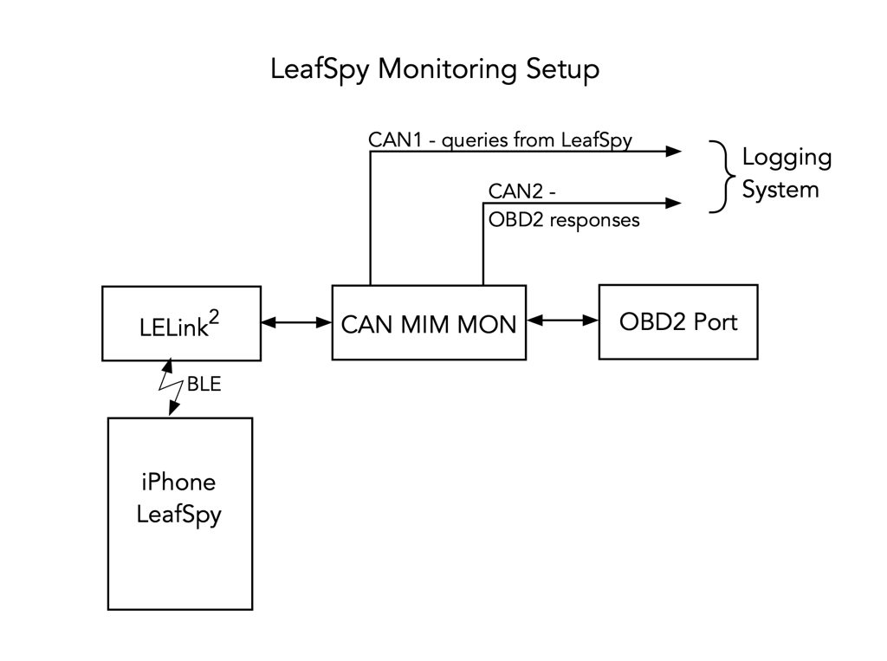
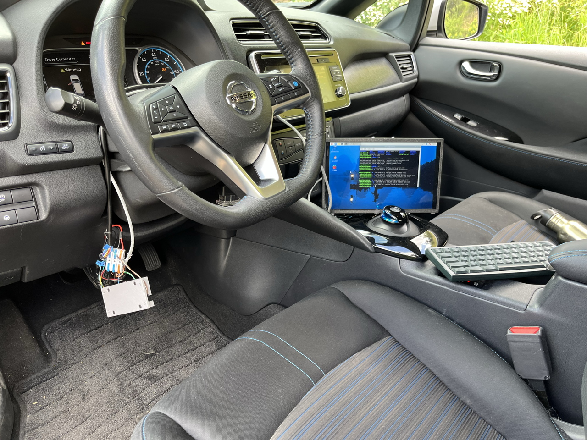

## LeafSpy OBD2 messages
Messages recorded on two CAN busses, one for messages from the OBD2 Bluetooth Low Energy dongle and one for responses from the car.





Messages were recorded during two sessions stored in separate directories here.

1. ```charging``` : While the car was L2 charging.
2. ```driving``` : While the car was driving or in drive mode.

In each directory there are two subdirectories, one for log files and one for a screenshot of LeafSpy during the logging session.
