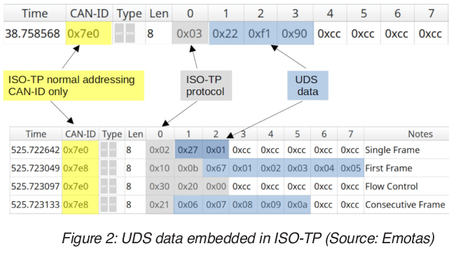
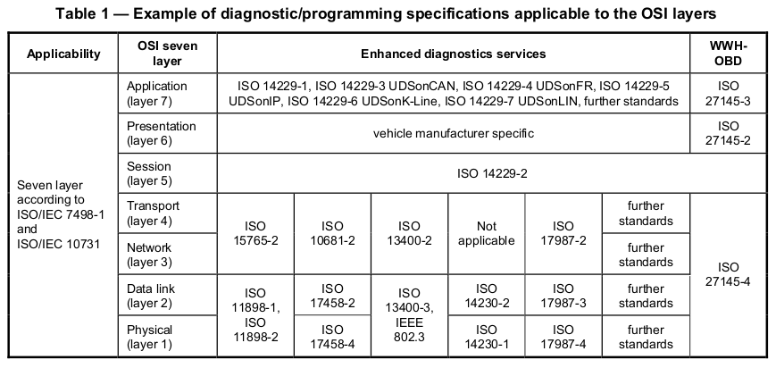

# Nissan Leaf CAN Data

This is a collection of CAN data and DBC files for the Nissan Leaf.

The intention is to get all the CAN data for different models of Nissan Leafs in one place as a resource for working with tools that use this data.

I was driven by my need for sample data for the 2011 ZE0 and being unable to find a DBC file that could decode the messages I was wanting to use.

Basically there is plenty of information on CAN messages for the Nissan Leaf but it is often for a different model from the one you need and the message formats have changed from model to model.

This repo will first focus on the ZE0 as that is what I have so what I can capture messages from.  Hopefully others may see this as a place to add information they have found for their model, but does risk just being another site with the same good intent, much like the XKCD situation with standards:


The structure of this repo is:
```
├── 2011_ZE0
│   └── ukoda
└── utils
```

In all folders there is a README.md that describes the files and sub-folders present in that folder.
* The README.md should list supporting links and credits where the work of others has helped source the information.
* For DBC files it should indicate what busses it relates to and what messages or group of messages it decodes.  Comments of completeness or limitations are often helpful.
* For captured data it should indicate which bus the data was captured from and what state the vehicle was in.
* For images it should indicate which data capture(s) it relates to.
* For PDF the original source should be provided.

At the top level is a folder for each model of Leaf that there is files for and a utils folder.

The utils folder contains utilities for working with DBC files.

In each vehicle folder there is DBC files for that model and there is a sub-folders for each user that has the related user's contributed message capture files.

We can optionally have supporting files such as:

* PDF documents that detail message formats.
* Images that show what the vehicle state is at the time of a capture, such as a photo of the vehicle dash or LeafSpy screen captures.

## Legal

All information presented here is from freely available sources.  This is the reason you will not find full ISO documents in this repo, they are copyrighted documents, so only fair use snippets and summaries are used from them.

If you feel any information in this repo is subject to legal restrictions and should not be present please bring it to my attention in the related [Issues](https://github.com/ukoda/NissanLeafCANData/issues) section at GitHub.

## CAN busses

Leaf has three ISO 15765‐4 (CAN 11/500) CAN busses, as detailed [here](https://leaf-obd.readthedocs.io/en/latest/diagnostic-connector.html), on the ODB2 port.

They are:

1. Pins 6 and 14. The Car CAN bus which has messages related to general vehicle operation including EV related messages.  It is the standard CAN bus for ODB2 adaptors and is the default to focus on unless you have a specific reason to focus on one of the other two.
2. Pins 13 and 12. The EV CAN bus which has messages related to the battery and drive system.
3. Pins 11 and 3.  The AV CAN bus which has messages related to the infotainment system.

For the Peak USB CAN adaptor it does not have an ODB2 type connector, just three screw terminals.  I used the connector and case from a cheap ELM327 adaptor that was unreliable and removed the PCBA from it.  I fitted a three way switch to select the bus I want to capture from the OSB2 connector and from the switch a cable to the Peak USB CAN.

## CAN message protocols

There are two types of CAN messages.

### Periodic messages

Firstly there is periodic messages send with an ID for use by any device that might need then.  You can simply passively listen to the CAN bus until a message with the ID of interest is received.  The messages are implemented to fit within the 8 byte data limit of the ISO 15765‐4.

### Requested messages

Secondly there is requested UDS messaging.  This where a connected device will send a message to a specific ECU which will reply to that message. These exceed the 8 byte data limit of the ISO 15765‐4 so two additional protocols are layered on top of the basic CAN protocol.

### Protocol stack

* ISO 14229-1 (UDS)
* ISO 15765-2 (ISO-TP)
* ISO 15765‐4 (CAN 11/500)

So the simple 8 bytes seen with typical CAN diagnostics tools is actually embedding a lot more as seen here:



At the top of the stack is ISO 14229-1 (UDS) more commonly known for use with diagnostic system tools.  This is where you are working with DIDs.  DID stands for Data Identifier. A DID basically identifies a piece of ECU data.

NB: As UDS is a 'diagnostic' message the ECU is expecting to be only communicating with one diagnostic device at a time as a 'session'.  So you may have problems if you have a custom status display then try to run LeafSpy or connect another custom device also using UDS.

As UDS data is too long to fit in the 8 byte limit the next layer on the stack is [ISO 15765-2 (ISO-TP)](https://docs.kernel.org/networking/iso15765-2.html) which uses multiple CAN messages to transfer the information defined in the UDS layer above it.

The the bottom is the familiar ISO 15765‐4 (CAN 11/500) which is what the psychical CAN hardware is dealing with and has the 11 bit ID number.

If you are familiar with the formal ISO 7 layer model then this is the full picture:



The good news is you can ignore much of that and simply send the correctly formatted CAN messages in the correct order and look for the right pattern in the replies.  If sending a message to an fails ECU fails to get a response you probably failed to send a needed earlier message that sets things up.  Looking at captures saved in the repo can help if you want to avoid reading and understanding UDS and ISO-TP.

## SavvyCAN

For collecting and analysing CAN message I use the open source cross platorm [SavvyCAN](https://savvycan.com/) software.

TODO: Added a link to SavvyCAN user guide if good one exists.

While the classic ELM327 type ODB2 adaptor is popular for accessing a desired subset of the CAN messages it needs to filter messages as it has serious performance limitation.  The main Leaf bus can have over 1000 CAN messages being sent every second when the car is ready to drive.  The ELM327 can only handle a fraction of that number of messages in a second.  Therefore I use a [Peak System CAN to USB adaptor](https://www.aliexpress.com/item/1005011625782729.html) which is cheap and can keep up with the full message rate of the Leaf CAN bus. NB: SavvyCAN recommend the CANDue board, which is about 10 times the price of the one I used.

There was a few issues with getting SavvyCAN and the Peak CAN USB set up and working on my Linux system.  The key steps on my Linux Mint system where:

1. [Downloaded SavvyCAN](https://github.com/collin80/SavvyCAN/releases) as a Linux AppImage to a location on path, changed to a+x and created softlink as savvycan.  If you only wish to view CAN captures your copy of SavvyCAN should now work.  The rest of the steps are to perform captures.
2. `sudo apt install libsocketcan2*`
3. Plug in the Peak CAN USB.  Check `dmesg` that is was detected as `can0`.
4. `sudo ip link set can0 up type can bitrate 500000`
5. Start SavvyCAN.
6. Open connection page from "Connection" menu.
7. Click "Add New Device Connection"
8. Select "Connection Type" as "QT SerialBus Devices(SocketCAN, PeakCAN, etc)
9. Select "SerialBus Device Type:" as "socketcan"
10. Select "Port:" as "can0". If `can0` is not a drop down option you have done something wrong.  Check step 3 again.
11. Click on "Create New Connection".

Packets should now start being captured. The Left two LEDs on the Peak CAN will be on and the right on will flash with packets. 

